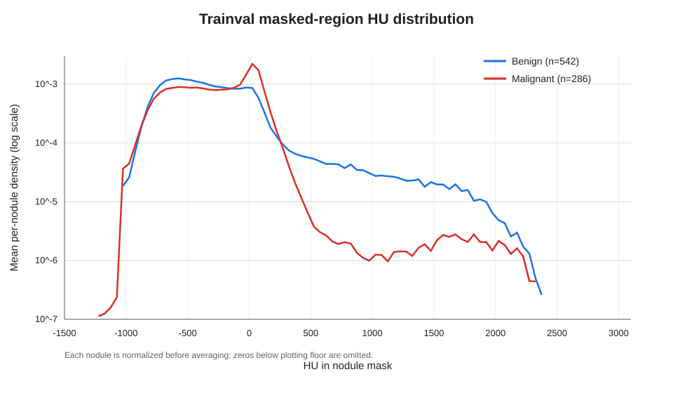
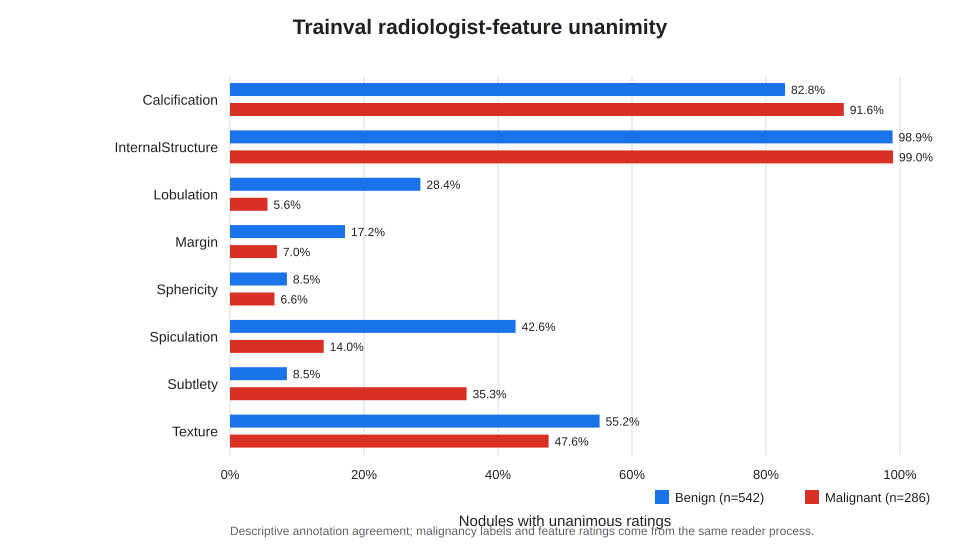

# LUNA16 Radiomics progress — 15 November 2026

## Shared metadata validation

- The shared `nodules.csv` and `splits.csv` each have 994 unique `voi_name` entries. The IDs match each other and the 994-row VOI spacing audit; patient ID, split, and fold agree for every row.
- The split is patient-level: 551 patients total, with no patient crossing between trainval and test. Trainval has 828 nodules from 460 patients; test has 166 nodules from 91 patients. The five trainval folds contain 165–166 nodules each; test rows use fold -1.
- The confirmed target is `malignant`, which agrees with `n_high >= 2` for all rows. Other available label columns differ and were not used.

## Feature extraction and QC

- Extracted both original-spacing and 1 mm isotropic features for all 828 trainval nodules: 1,656 rows total, 107 Radiomics features per row, no duplicate nodule/protocol rows, no extraction failures, and no NaN or infinite feature values.
- Extracted both protocols for the 166 test nodules after writing the evaluation plan: 332 rows, 107 features per row, no failures or non-finite values. The pre-specified test metrics were calculated once and are documented below.
- Settings: Python 3.11.18, PyRadiomics 3.0.1, SimpleITK 2.5.7, `binWidth=25`, `normalize=False`, Bspline image interpolation, label 1, and 3D extraction.
- The trainval-only paired feature-change summary is `results/radiomics_trainval/feature_change_summary.csv`. It is descriptive preprocessing sensitivity analysis, not feature selection or protocol tuning.

## PyRadiomics-aligned mask geometry

The three sample pairs were audited using PyRadiomics' ROI-aligned resampling routine:

| Nodule | Original voxels | Resampled voxels | Original volume (mm³) | Resampled volume (mm³) | Change | Grid size XYZ |
|---|---:|---:|---:|---:|---:|---|
| LIDC-IDRI-0292_R_1 | 446 | 126 | 137.809753 | 126.0 | −8.569606% | 19×19×9 |
| LIDC-IDRI-0470_R_2 | 10,427 | 6,516 | 6,443.687439 | 6,516.0 | +1.122223% | 45×38×28 |
| LIDC-IDRI-0144_R_2 | 376 | 524 | 517.792413 | 524.0 | +1.198856% | 24×23×13 |

These geometry results cover three samples only; they do not establish which protocol performs best.

## Baseline evaluation

The pre-specified plan compared diameter only, all 107 Radiomics features, and diameter plus Radiomics under both extraction protocols. It used the shared five folds and fixed L2 logistic regression (`C=1.0`), with median imputation and scaling fitted inside each training fold. No feature selection or hyperparameter tuning was performed. The six planned test comparisons were run once; no choice was changed based on their results.

| Protocol | Input | Trainval OOF ROC-AUC | Test ROC-AUC (95% patient-bootstrap CI) |
|---|---|---:|---:|
| Original spacing | Diameter | 0.913 | 0.961 (0.927–0.988) |
| Original spacing | Radiomics | 0.927 | 0.929 (0.892–0.964) |
| Original spacing | Diameter + Radiomics | 0.927 | 0.930 (0.893–0.965) |
| 1 mm isotropic | Diameter | 0.913 | 0.961 (0.927–0.988) |
| 1 mm isotropic | Radiomics | 0.924 | 0.937 (0.892–0.975) |
| 1 mm isotropic | Diameter + Radiomics | 0.924 | 0.937 (0.892–0.975) |

The test intervals overlap substantially, and the test point estimates do not show a stable Radiomics gain over diameter. This is an initial baseline on 166 test nodules from 91 patients, not grounds to select a resampling protocol or claim model superiority. Average precision, all confidence intervals, and per-nodule predictions are in `results/baseline_evaluation/baseline_metrics.csv` and `test_predictions.csv`; keep patient-level predictions local.

## Trainval-only feature stability screen

- A univariate ANOVA F-score screen was run separately within each of the five trainval folds and each extraction protocol. For every fold, only the other four folds were used to rank features; the held-out test set was not read.
- Nine features appeared in the top 10 in all five folds for both protocols. Most are shape or size-related features, so this screen does not demonstrate information beyond annotated diameter and must not be treated as a final feature set.
- This is a descriptive ranking-stability check only. No feature subset was used to train or evaluate a model, and no test-set result was consulted. The complete summary is `results/radiomics_trainval/feature_selection_stability.csv`.

The environment used for the Radiomics and selected-feature runs had scikit-learn 1.9.1 installed; the repository `requirements.txt` pins this version.

## Trainval-only selected-feature model comparison

The comparison used nested, patient-grouped cross-validation entirely within the shared trainval set. For each outer fold, the number of features (k = 5, 10, 20, or 50) was chosen by four-fold grouped inner CV using ROC-AUC. ANOVA F-score ranking, median imputation, scaling, and L2 logistic regression (`C=1.0`) were fitted within the relevant training folds. The outer validation fold was not used for selection. The script did not read test features, test predictions, or test metrics.

Implementation: `src/evaluate_selected_features_trainval.py`; the locked analysis choices are recorded in `SELECTED_FEATURE_ANALYSIS_PLAN.md`.

| Protocol | Input | Outer trainval OOF ROC-AUC | Outer trainval OOF average precision |
|---|---|---:|---:|
| Original spacing | Diameter | 0.9126 | 0.8405 |
| Original spacing | All Radiomics | 0.9269 | 0.8733 |
| Original spacing | Diameter + all Radiomics | 0.9269 | 0.8731 |
| Original spacing | Selected Radiomics | 0.9305 | 0.8723 |
| Original spacing | Diameter + selected Radiomics | 0.9304 | 0.8716 |
| 1 mm isotropic | Diameter | 0.9126 | 0.8405 |
| 1 mm isotropic | All Radiomics | 0.9235 | 0.8695 |
| 1 mm isotropic | Diameter + all Radiomics | 0.9236 | 0.8692 |
| 1 mm isotropic | Selected Radiomics | 0.9258 | 0.8592 |
| 1 mm isotropic | Diameter + selected Radiomics | 0.9261 | 0.8596 |

Inner CV selected k=20 in every outer fold for both selected-feature inputs and both protocols. Selected features gave slightly higher pooled ROC-AUC than the corresponding all-feature models, while average precision was lower, especially for the 1 mm protocol. These are exploratory trainval results without confidence intervals; they do not establish a reliable improvement or justify a protocol choice. The aggregate metrics, per-fold k values, and selected feature names are in `results/radiomics/selected_feature_metrics_trainval.csv`, `selected_feature_k_by_fold_trainval.csv`, and `selected_features_by_fold_trainval.csv`.

## Trainval-only masked-region HU distribution

The CT intensity summary used the 828 trainval VOIs and their binary masks at native image spacing. For each nodule, HU statistics were calculated only from mask-label-1 voxels. Histogram densities were normalised within each nodule and then averaged by label, so larger masks did not contribute more weight. No test images or test labels were used, and no model or preprocessing parameter was selected from these summaries.

| Label | Nodules | Median of per-nodule median HU | IQR of per-nodule median HU | Median per-nodule q90 HU | Median fraction of mask voxels > 0 HU |
|---|---:|---:|---:|---:|---:|
| Benign | 542 | −361.0 | −501.0 to −194.1 | −20.3 | 0.076 |
| Malignant | 286 | −199.5 | −340.6 to −39.0 | 55.5 | 0.255 |

The malignant-labelled nodules had higher median intensities in this descriptive summary, but the distributions overlap. This does not show that HU intensity independently predicts malignancy or improves a model; the labels are radiologist ratings and the masks define the sampled voxels. The histogram bins and aggregate statistics are in `results/eda/hu_histogram_trainval.csv` and `hu_class_summary_trainval.csv`. Per-nodule statistics are in `hu_per_nodule_trainval.csv` and should remain local. The aggregate histogram is visualised in `results/figures/eda/hu_distribution_trainval.svg`.

## Trainval-only radiologist feature distribution and agreement

Radiologist feature ratings were matched to the shared trainval nodules by nearest 3D centre within the same patient, with a 5 mm acceptance limit. The 3,050 matched annotation rows exactly reproduced the expected `n_raters` count for each of the 828 trainval nodules; 13 more distant rows were excluded. Category distributions are equal-weighted by nodule. Exact agreement was highest for internal structure (about 99%) and lower for lobulation, margin, sphericity, and subtlety. For example, unanimous spiculation ratings occurred in 42.6% of benign-labelled and 14.0% of malignant-labelled nodules; unanimous subtlety ratings occurred in 8.5% and 35.3%, respectively.

The analysis is implemented in `src/analyze_annotator_features_trainval.py`. Aggregate unanimity rates are visualised in `results/figures/eda/annotator_agreement_trainval.svg`.

These are descriptive distributions of radiologist opinions. Because the malignancy label and these features arise from the same annotation process, the differences do not establish independent predictive value. No hypothesis tests, classifier, feature selection, or test-set analysis was performed. The aggregate tables and method note are `results/eda/annotator_feature_category_distribution_trainval.csv`, `annotator_feature_agreement_trainval.csv`, and `annotator_feature_summary_trainval.md`. The per-nodule ratings and agreement table remain local.

## CNN preprocessing QA (trainval only)

The existing preprocessing pipeline was run on the 828 shared trainval VOIs only. It produced finite `(828, 1, 64, 64)` patches in `[0, 1]`, with no empty patch masks or image-mask shape/affine mismatches. Visual spot-checks found no obvious centring or orientation failure. Padding occurred in 76.6% of patches; its raw ROC-AUC for the malignant label was 0.419 (reverse direction 0.581), while its Spearman correlation with native in-plane spacing was −0.942. This raises a possible acquisition-resolution shortcut. No parameter was changed, and no test rows or images were processed. Details: `results/preprocessing_qa_trainval.md`; local-only patch arrays and image previews are under `data/processed/`.

A planned geometry-only comparison kept pixel size at 0.5 mm and compared a 32 mm (64 × 64) with a 40 mm (80 × 80) view on the same trainval set. The larger view reduced mask-edge contact from 3.6% to 1.6%, but increased any-padding prevalence from 76.6% to 97.6% and median padding from 0.136 to 0.447. Its central 32 mm was identical to the original patch. This comparison did not train a classifier or select a window; the full CT is needed to obtain genuine surrounding tissue outside the VOI.

Reproducible aggregate output: `results/preprocessing_window_comparison_trainval.csv`; script: `src/compare_preprocess_windows_trainval.py`.

## Exploratory CNN baseline (trainval only)

The small 2D CNN in `src/train.py` was evaluated with the five shared patient-level trainval folds. For each outer fold, a patient-grouped inner validation split selected the epoch; the CNN was then refit on the full outer training portion. A diameter-only logistic regression was recomputed on the same outer folds. The script used only 828 trainval patch rows and did not read held-out test images, labels, predictions, or metrics.

| Model | Mean fold ROC-AUC ± SD | Mean fold average precision ± SD | Mean fold sensitivity | Mean fold specificity |
|---|---:|---:|---:|---:|
| CNN, 32 mm central slice | 0.885 ± 0.018 | 0.820 ± 0.021 | 0.510 | 0.928 |
| Diameter logistic regression | 0.912 ± 0.019 | 0.847 ± 0.039 | 0.668 | 0.939 |

This exploratory CNN baseline was below the diameter-only baseline on fold-mean metrics. It is one fixed architecture/run, not a tuned or final model; no test-set result informed a choice. Aggregate outputs: `results/cnn/cnn_trainval_by_fold.csv` and `results/cnn/cnn_trainval_summary.csv`. Per-nodule out-of-fold predictions remain local under ignored `data/processed/`. Runtime: Python 3.11.18, PyTorch 2.7.0, CPU, two threads.

### Initial CNN subgroup error analysis (trainval only)

The fixed CNN and same-fold diameter OOF scores were summarized by nodule size group, slice-thickness group, label-rule agreement, and padding fraction. The analysis used only the 828 trainval OOF predictions and metadata; no test rows were accessed. A fixed 0.5 score threshold was used for sensitivity/specificity and was not tuned. The CNN AUC was 0.556 in small nodules (13 malignant cases), 0.700 in medium nodules, and 0.656 in large nodules. In ambiguous-label nodules (165 total), CNN AUC was 0.673 versus 0.882 among 663 nodules where all three label rules agreed. CNN AUC also varied by padding: 0.901 with zero padding, 0.824/0.874 in lower/middle positive-padding tertiles, and 0.721 in the highest tertile. Diameter remained stronger in these summaries. This padding association is a warning signal, not proof that the CNN uses padding, because padding is related to source spacing and nodule geometry. The small and stratified samples are descriptive and uncertain; pooled OOF scores also come from separately fitted fold models, so their calibration may differ.

Outputs: `results/cnn/cnn_trainval_subgroup_metrics.csv` and `results/cnn/cnn_trainval_error_analysis.md`; reproducible script: `src/analyze_cnn_errors_trainval.py`. The patient-level OOF file remains local and must not be uploaded.

### CNN input ablation (trainval only)

Four fixed CNN inputs were compared on the same 828 shared trainval nodules and five patient-level outer folds: 32 mm/one slice/HU max 400 (baseline), 40 mm/one slice/HU max 400, 32 mm/three slices at -1/0/+1 mm/HU max 400, and 32 mm/one slice/HU max 600. Each variant used the same CNN/optimizer settings and an inner patient-grouped split for epoch selection. A diameter-only logistic reference was refit on the same folds. Only trainval image-mask pairs were opened; no test images, labels, predictions, or metrics were used.

| Input | Mean fold ROC-AUC ± SD | Mean fold average precision ± SD |
|---|---:|---:|
| 32 mm, one slice, HU max 400 | 0.885 ± 0.018 | 0.820 ± 0.021 |
| 40 mm, one slice, HU max 400 | 0.885 ± 0.026 | 0.802 ± 0.035 |
| 32 mm, three slices, HU max 400 | 0.877 ± 0.018 | 0.801 ± 0.025 |
| 32 mm, one slice, HU max 600 | 0.889 ± 0.017 | 0.811 ± 0.027 |
| Diameter logistic reference | 0.912 ± 0.019 | 0.847 ± 0.039 |

No CNN input variant clearly improved on the 32 mm baseline in both metrics, and all remained below the diameter reference. The small AUC increase for HU max 600 is exploratory and does not establish a preferred setting. This is a single-seed comparison; 40 mm inputs may contain additional air outside the stored VOIs, and multi-slice offsets interact with variable native slice thickness. No CNN test evaluation was performed. The locked test set has already been used for the pre-specified Radiomics baseline comparison, so any further test analysis must be explicitly agreed and must not guide input selection.

Plan: `CNN_INPUT_ABLATION_PLAN.md`; script: `src/run_cnn_input_ablations_trainval.py`; aggregate results: `results/cnn/cnn_input_ablation_summary_trainval.csv`, `results/cnn/cnn_input_ablation_by_fold_trainval.csv`, and `results/cnn/cnn_input_ablation_report_trainval.md`. Per-nodule OOF predictions and generated patch arrays remain local.

## Next steps

1. Add the new trainval-only resampling and CNN-input-ablation scripts/results to the repository and link them in the README; keep CT/VOI images, masks, patient-level tables, per-nodule outputs, generated patches, and local preview images out of GitHub.
2. Complete and cite the related-work review.
3. Decide with the group whether any further CNN experiment is needed. The current input ablation is single-seed and exploratory; further comparisons should be specified in advance and use trainval only.
4. Detection remains not started and requires access to the full CT data. The test set was already evaluated for the pre-specified Radiomics baseline; do not use it to tune inputs or models. Any additional test analysis needs an explicit, documented rationale.
